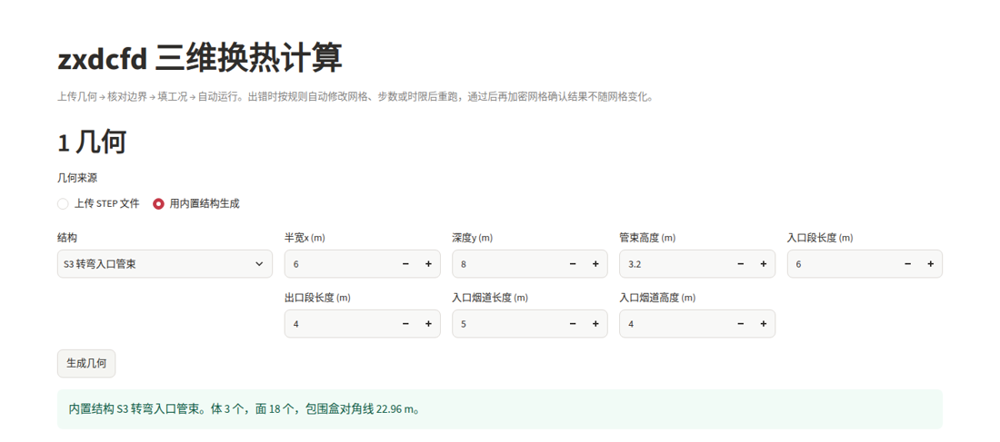
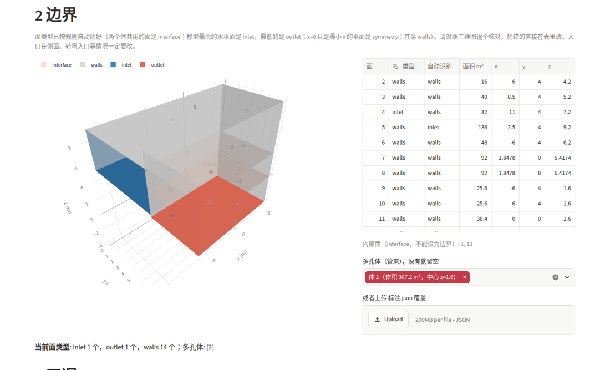
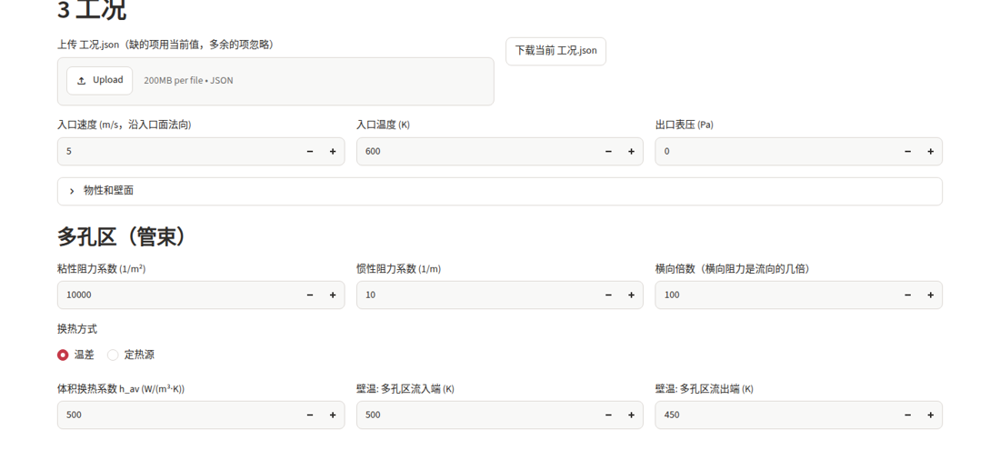
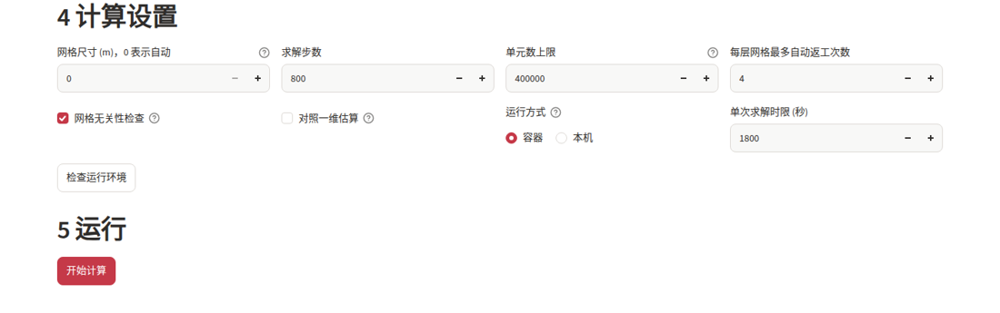
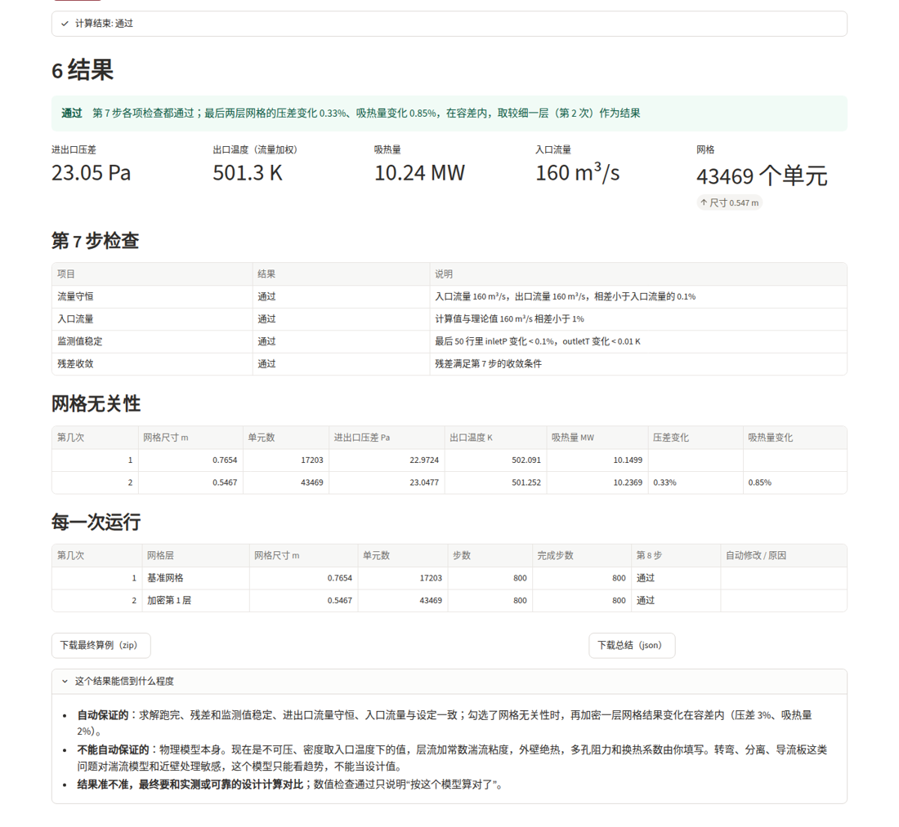

# 用户使用说明：网页界面

这份说明按用户实际操作的顺序，讲清楚打开网页后看到什么、要填什么、出错时会怎样、结果怎么看。规则细节见 [网页界面与自动运行](09-网页界面与自动运行.md)。

> 截图说明：第 1–5 步的截图是 `app.py` 在没有 Docker 的机器上真实运行的界面；第 6 步结果区的截图回放的是 CI 里 S3 真实自动运行的日志和数值（[CI 运行](https://github.com/zhangxudun/zxdcfd/actions/runs/44859668688)），只有“第 7 步检查”表的说明文字是简写。

## 一句话

用户上传一个三维模型（或选内置结构），在三维图上确认哪个面是入口、哪个面是出口、哪块是管束，填好烟气和管束参数，点“开始计算”。程序自动划网格、写算例、用 OpenFOAM 求解、检查结果；不收敛就自己加步数或加密网格重算，算对了再加密一层网格确认结果不随网格变化，最后给出压差、出口温度、吸热量和可信度说明。

## 用户需要准备什么

| 项目 | 要求 |
|---|---|
| 运行环境 | 自己电脑：装好 Docker Desktop 并启动，执行 `pip install gmsh streamlit plotly`，在仓库目录执行 `streamlit run app.py`，浏览器打开 http://localhost:8501 |
| 几何 | STEP 文件（.step / .stp），单位按 m。一般是三段实体：入口段、管束段、出口段，接触面要贴合。也可以不准备文件，直接用内置 S1–S3 |
| 工况 | 入口烟气速度和温度、出口压力、烟气物性；管束的阻力系数和换热参数。可以一次填好存成 `工况.json`，下次直接上传 |

## 操作流程

### 第 1 步：给几何



- 选“上传 STEP 文件”，把文件拖进来；或者选“用内置结构生成”，选结构（S1 直段、S2 变截面、S3 转弯入口），改尺寸后点“生成几何”。
- 读入成功会显示绿色提示：几个体、几个面、模型多大。读不了会显示红色原因，比如文件里没有实体。

### 第 2 步：核对边界（最需要用户动脑的一步）



- 左边三维图按类型着色：蓝色是入口，红色是出口，灰色是壁面，浅色是内部交界面；每个面标了编号，可以用鼠标旋转、缩放。
- 右边表格是每个外表面：程序自动猜的类型在“自动识别”列，用户要用的类型在“类型”列，点一下就能改成 inlet / outlet / symmetry / walls。面积和面心坐标用来对照三维图找面。
- 自动猜的规则：最高的水平面是入口，最低的水平面是出口，x=0 的最小平面是对称面，其余是壁面。入口在侧面（如 S3）时一定要改；上图里内置 S3 已经自动把侧面 4 号面设成入口、顶面 5 号面改回壁面。
- 下面选哪个体是多孔区（管束）。三个体时自动选中间那个。
- 也可以上传以前保存的 `标注.json` 一次改好。
- 下方一行汇总当前有几个入口、几个出口。没有入口或出口时会红字提示，“开始计算”按钮不能点。

### 第 3 步：填工况



| 分组 | 字段 | 说明 |
|---|---|---|
| 入口 | 速度（m/s）、温度（K） | 速度沿入口面法向 |
| 出口 | 表压（Pa） | 一般填 0 |
| 物性和壁面（折叠） | 工作压力、摩尔质量、比热、湍流粘度、湍流普朗特数、壁面滑移 / 无滑移 | 不常改，默认收起 |
| 多孔区 | 粘性阻力系数、惯性阻力系数、横向倍数 | 有多孔体时才显示 |
| 换热方式 | 温差：体积换热系数 h_av、多孔区流入端和流出端的管壁温度；定热源：体积热源（吸热为负） | 二选一 |

- 默认值是一组“合理但人为”的数，只用来先跑通，不代表某台设备。
- 右上角“下载当前 工况.json”可以把这次填的保存下来；下次“上传 工况.json”直接读入，缺的项保留当前值，不认识的项会提示忽略了哪些。

### 第 4 步：计算设置（一般不用动）



| 设置 | 默认 | 什么时候改 |
|---|---|---|
| 网格尺寸 | 0，表示自动取模型对角线的 1/30 | 想一开始就用细网格时填具体数值 |
| 求解步数 | 800 | 不收敛时程序会自己加倍，一般不用改 |
| 单元数上限 | 400000 | 电脑慢就调小；想网格更细就调大 |
| 每层网格最多自动返工次数 | 4 | 一般不改 |
| 网格无关性检查 | 勾选 | 只想快速看个大概时取消，计算时间约减半 |
| 对照一维估算 | 不勾 | 只有 S1 这类等截面、来流均匀的管束才勾 |
| 运行方式 | 容器 | 机器上直接装了 OpenFOAM 时选“本机” |
| 单次求解时限 | 1800 秒 | 超时程序会自己加倍 |

“检查运行环境”按钮会告诉用户 Docker 有没有启动、OpenFOAM 镜像有没有下载（第一次计算会自动下载，约 1 GB）。

### 第 5 步：开始计算

点“开始计算”后出现一个进度框，逐行显示每一步，例如 S3 的实际过程：

```
[第 2 步] 识别边界，套用标注，校验工况
[第 3 步] inlet 面 [4]，outlet 面 [18]，多孔体 [2]
[第 1 次] 基准网格，网格尺寸 0.76539 m，步数 800
  第 4 步 网格: 尺寸 0.76539 m，四面体 17203 个，体积偏差 0%
  第 6 步 完成 800 步，用时 53 秒
  第 7 步 通过   流量守恒 / 入口流量 / 监测值稳定 / 残差收敛
[网格无关性] 第 1 层加密: 网格尺寸 0.76539 → 0.546707 m
[第 2 次] 加密第 1 层 …… 四面体 43469 个，用时 80 秒
[网格无关性] 与上一层相比: 压差变化 0.33%（允许 3%），吸热量变化 0.85%（允许 2%）
[结论] 通过
```

S3 这一组在 CI 机器上总共约 2–3 分钟。网格越细、加密层数越多，时间越长。

### 第 6 步：看结果



从上到下：

1. **结论横幅**：绿色“通过”、黄色“网格无关性未确认”、红色“需要人工”或“未通过”，后面跟一句原因。
2. **五个数**：进出口压差、出口温度（流量加权）、吸热量、入口流量、网格单元数。
3. **第 7 步检查表**：每项通过与否和具体数值。
4. **网格无关性表**：每层网格的结果和相邻两层的变化百分比。
5. **每一次运行表**：每次用了什么网格和步数，第 8 步结论，以及程序自动改了什么（比如“残差收敛不通过，步数 800 → 1600”）。
6. **残差和监测曲线**（实际运行时显示；截图是回放，所以没有）。
7. **下载**：最终算例 zip（可以拿去 ParaView 看流场）、运行报告、总结 json。
8. **“这个结果能信到什么程度”**：说明哪些是程序保证的，哪些不是。

如果算完以后用户又改了几何、边界或工况，结果区顶部会提示“结果对应的是上一次的输入”。

## 出错时用户看到什么

| 情况 | 程序怎么做 | 用户看到 |
|---|---|---|
| 残差或监测值没稳定 | 步数加倍重算，最多到 6400 步 | 每次运行表里写“步数 800 → 1600”，最终仍可能是“通过” |
| 网格太粗、网格检查不通过、计算发散 | 网格尺寸乘 0.75 重算 | 写明加密原因和新尺寸 |
| 求解超时 | 时限加倍重算 | 写明新时限 |
| 加密会超过单元数上限 | 停下 | 黄色“网格无关性未确认”或红色“未通过”，提示调高上限 |
| 没有入口或出口、标注错 | 不算 | 开始前就红字提示；或者结论“需要人工”，告诉回到哪一步改什么 |
| Docker 没启动 | 不重试 | “需要人工：运行环境有问题”，并给出原因 |
| 入口流量和设定不符（加密一次后仍不符） | 停下 | 提示多半是入口面标错或速度填错 |

## 结果能信到什么程度

- **程序保证**：按当前模型算对了，也就是收敛、流量守恒、入口流量正确、结果与网格无关。
- **程序不保证**：模型符合实际。现在是不可压、层流加常数湍流粘度、外壁绝热、默认壁面滑移，阻力和换热系数是用户填的。转弯、导流板一类问题只能看趋势。
- 进出口压差是静压差，入口和出口截面流速不同时包含动压变化，不能直接和只算管束阻力的一维估算比。

## 现在还做不到的

- 流动方向固定为从上往下（-z），多孔区的阻力方向也按这个方向设置，界面上不能改。
- 只支持一个多孔区内用一组阻力和换热参数；不能分区设置。
- 只适合一个人在本机用：多人同时计算会互相干扰，关掉网页计算可能中断，没有登录和任务排队。给别人在网页上用需要另外改造（见上一轮讨论的云服务器方案）。
- 没有在线看流场云图，要下载算例用 ParaView 看。

## 请你确认

1. 第 2 步用“三维图 + 表格改类型”核对边界，是否够用？还是希望直接在三维图上点面来改？
2. 工况字段和单位是否符合你的习惯（比如温度用 ℃ 还是 K、速度还是流量）？
3. 结果区要不要加流场云图（温度、速度剖面），以及管束入口的速度均匀性？
4. 下一步优先做多人网页访问，还是先补这些功能？
