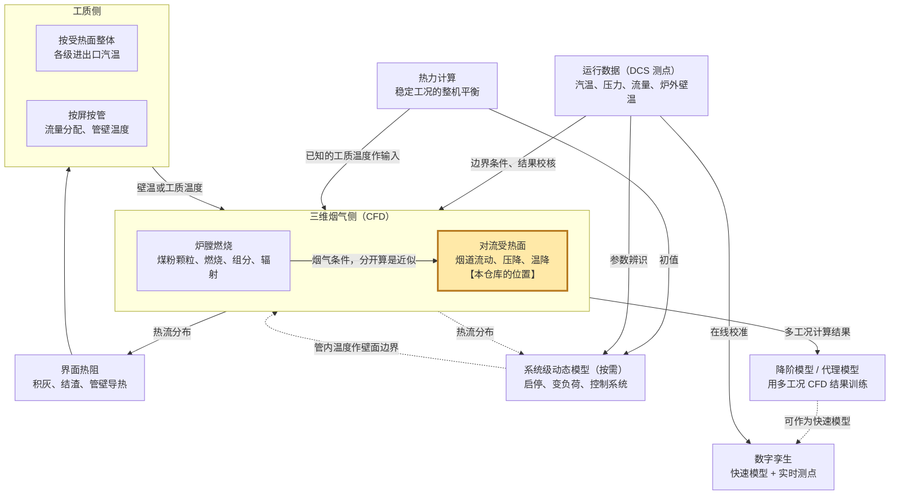

# 仿真架构关系

> 本文是概念梳理，不是已实现的功能，也不是开发计划。仓库目前只实现了图中“对流受热面”这一格里的 `simpleFoam` 路径，现状见第 4 节。图中的关系有一部分是整理者的概括，依据和局限见第 6 节。

## 1. 架构图

## 2. 怎么读

- 实线是稳定工况分析里的数据流，虚线是按需选用的。
- 烟气侧和工质侧互相牵制：烟气侧给出热流分布，经过界面热阻，工质侧算出壁温或工质温度再传回，迭代到两侧一致。
- 工质侧有两种粒度。按受热面整体耦合只交换各级的平均汽温，能预测各级汽温，给不出单管温度；按屏按管耦合要把集箱和各屏回路建出来，用来查超温管。
- 工质温度已知时（来自热力计算或测点），可以不做耦合，直接作为烟气侧的输入。本仓库现在就是这种用法。
- 系统级动态模型只在算启停、变负荷时需要。它使用烟气侧给出的热流分布，并把管内温度回传作壁面边界；初值来自稳态的热力计算，参数可用运行数据辨识。
- 代理模型和数字孪生可以建在 CFD 结果之上，但不是必须逐层搭建：代理模型可以只用烟气侧 CFD 训练，数字孪生也可以用别的快速模型。
- 炉膛和对流受热面的分界是近似。屏式过热器位于炉膛上部，受炉内辐射影响，两者也可以放在同一个计算域里算。这一条是整理者的判断。
- 大涡模拟是烟气侧 CFD 的一种更高精度的做法，不是单独的模块。它需要超算，不属于日常手段，所以没有画成框。
- 计算规模（并行、网格能力）不对应图中任何一个框，需要单独解决。

## 3. 各部分解决的问题

| 部分 | 解决的问题 |
|---|---|
| 炉膛燃烧 | 炉膛燃烧、组分、炉内辐射 |
| 对流受热面 | 烟道和对流受热面的定常流动、压降、温降 |
| 界面热阻 | 积灰、结渣和管壁导热造成的烟气侧与工质侧温差 |
| 工质侧，按受热面整体 | 变煤种、调燃烧后各级汽温的变化 |
| 工质侧，按屏按管 | 各屏流量分配、单管壁温 |
| 热力计算 | 稳定工况下整机的热平衡 |
| 系统级动态模型 | 启停、变负荷等随时间变化的过程 |
| 降阶模型 / 代理模型 | 计算速度 |
| 运行数据、数字孪生 | 用实测数据校核和修正计算结果 |

## 4. 本仓库的现状

- 算法：按不可压处理，密度取入口温度下的值；湍流用一个常数粘度；管束用多孔区代替；外壁绝热。
- 能做：工质侧条件已知时，计算烟道和多孔区的整体压降和出口烟温。
- 还不能做：可信的烟气侧偏差分布、大温降工况、壁面换热、辐射。详见 [工作流程](工作流程.md) 第 5 节和 issue #5。

## 5. 本仓库接入这张图需要的接口

以下均未实现：

1. 入口接受非均匀的速度、温度分布（来自炉膛模型或实测）。
2. 按位置导出壁面和多孔区的热流，供工质侧模型使用。
3. 壁温可以按位置回填，而不只是顶部到底部线性分布。
4. 批量运行工况并结构化输出结果，供代理模型训练使用。

## 6. 证据来源与局限

- 本文依据的文献大多只读了摘要或搜索结果里的片段，没有读全文。
- 文献里的耦合案例多数基于 Fluent、APROS 等商业软件。用 OpenFOAM 全部自建的完整先例没有查到。
- 第 7 节里“CFD 与一维过程模型耦合”那篇的研究对象是碱回收锅炉，不是电站煤粉锅炉，只用来说明耦合方法。
- 图中的框和连线是对这些做法的概括，没有在本仓库里做过任何验证。

## 7. 参考

- 烟气侧 CFD 与汽水循环按受热面整体耦合迭代（320 MW 燃煤锅炉），文中也提到 Fluent 与 APROS 的耦合做法：<https://www.tandfonline.com/doi/full/10.1080/19942060.2021.1890227>
- CFD 与一维过程模型按屏耦合（碱回收锅炉过热器区）：<https://imisrise.tappi.org/TAPPI/Products/19/PEE/19PEE35.aspx>
- 过程模型里的管壁和积灰层热阻：<https://open.uct.ac.za/server/api/core/bitstreams/31da1cc1-1094-46cb-b3f2-8e835f373bfe/content>
- 用 DCS 历史数据辨识集总参数动态模型：<https://patents.google.com/patent/CN106326534A/zh>
- 用降阶模型快速预测煤粉锅炉内的温度和组分分布：<https://www.sciencedirect.com/science/article/abs/pii/S0360544223010575>
- 融合 CFD 和测点数据的数字孪生（水冷壁温度）：<https://link.springer.com/article/10.1007/s11630-025-2126-1>
- 1000 MWe 超超临界锅炉的大涡模拟：<https://link.springer.com/chapter/10.1007/978-3-319-69953-0_13>
