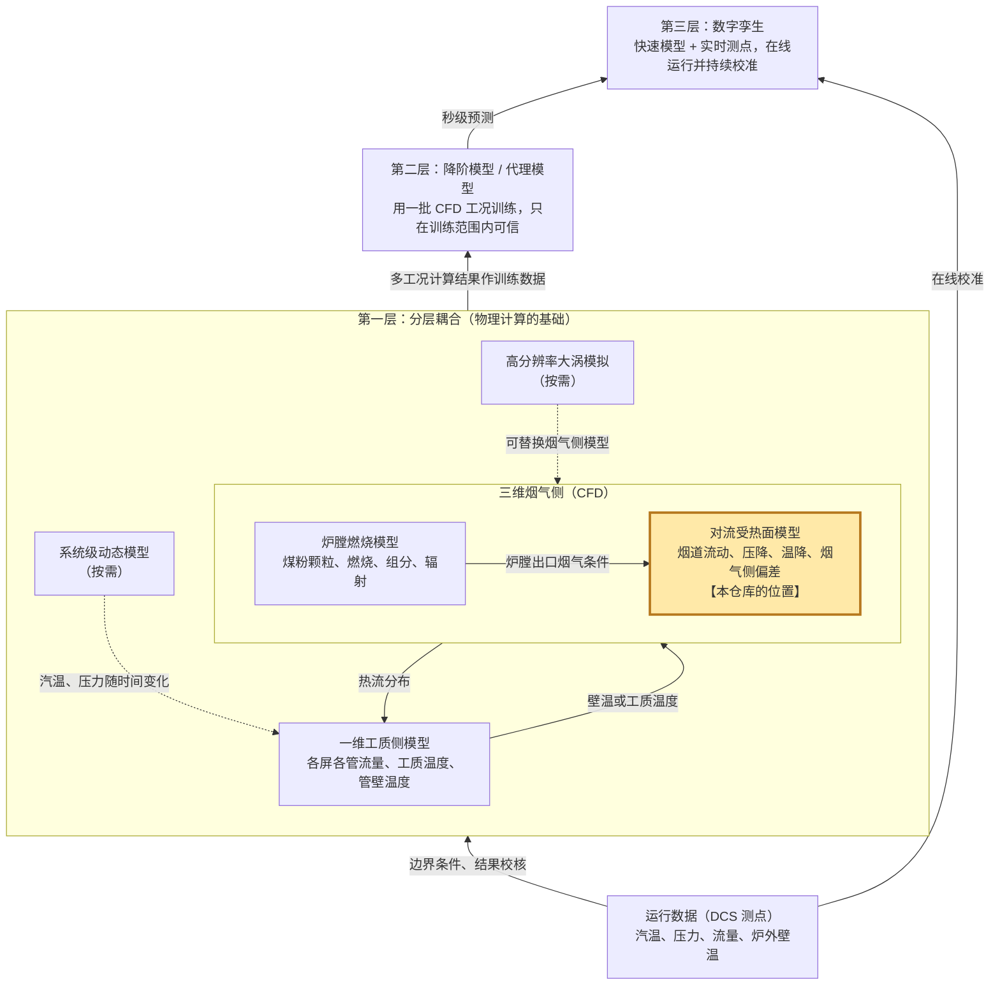

# 仿真架构关系

> 本文是概念梳理，不是已实现的功能。仓库目前只实现了图中“对流受热面模型”这一格里的 `simpleFoam` 路径，其余各框均未实现，也未列入计划。当前的限制见 [工作流程](工作流程.md) 第 5 节和 issue #5。

## 1. 架构图

## 2. 怎么读

- 从下往上是依赖关系：分层耦合提供物理计算结果，代理模型用这些结果训练，数字孪生再接上实时测点。
- 第一层内部是数据交换：烟气侧把热流分布交给工质侧，工质侧把壁温或工质温度传回，迭代到两侧一致。
- 运行数据有两个作用：给第一层提供边界条件和校核依据，给数字孪生做在线校准。
- 虚线是按需选用的：系统级动态模型只在算启停、变负荷时需要，只算稳定工况时由热力计算代替；大涡模拟只提高烟气侧精度。

## 3. 各框解决的问题

| 框 | 解决的问题 |
|---|---|
| 炉膛燃烧模型 | 炉膛燃烧、组分、炉内辐射 |
| 对流受热面模型 | 烟道和对流受热面的定常流动、压降、温降、流场均匀性 |
| 一维工质侧模型 | 单管壁温、各屏流量分配 |
| 系统级动态模型 | 启停、变负荷等随时间变化的过程 |
| 运行数据、数字孪生 | 用实测数据校核和修正计算结果 |
| 降阶模型 / 代理模型 | 计算速度 |

计算规模（并行、网格能力）不对应图中任何一个框，需要单独解决。

## 4. 本仓库接入这张图需要的接口

以下均未实现：

1. 入口接受非均匀的速度、温度分布（来自炉膛模型或实测）。
2. 按位置导出壁面和多孔区的热流，供工质侧模型使用。
3. 壁温可以按位置回填，而不只是顶部到底部线性分布。
4. 批量运行工况并结构化输出结果，供代理模型训练使用。

## 5. 参考

- 烟气侧 CFD 与汽水循环的耦合迭代：<https://www.tandfonline.com/doi/full/10.1080/19942060.2021.1890227>
- CFD 与一维过程模型耦合（过热器区）：<https://imisrise.tappi.org/TAPPI/Products/19/PEE/19PEE35.aspx>
- 融合 CFD 和测点数据的数字孪生（水冷壁温度）：<https://link.springer.com/article/10.1007/s11630-025-2126-1>
- 1000 MWe 超超临界锅炉的大涡模拟：<https://link.springer.com/chapter/10.1007/978-3-319-69953-0_13>
