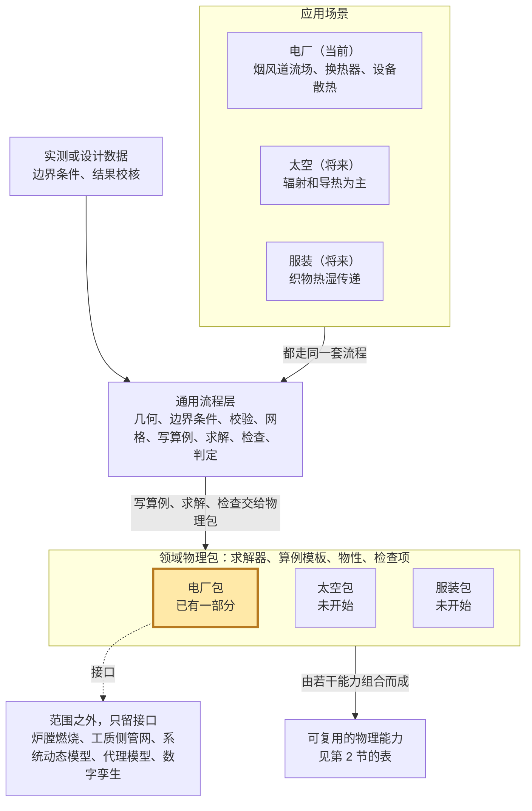

# 仿真架构关系

> 本文是概念梳理，不是已实现的功能，也不是开发计划。仓库目前只实现了电厂包里的不可压流动和多孔区换热（`simpleFoam` 路径），太空和服装两个方向没有任何代码。文中未注明来源的对应关系是整理者的判断，依据和局限见第 7 节。

## 1. 分层图

- 每个应用场景都走同一套八步流程。
- 流程里与物理有关的部分（写算例、求解、检查结果）交给领域物理包。
- 物理包由若干物理能力组合而成，能力可以跨领域复用，见第 2 节。
- 虚线连到的是范围之外的内容，只留接口，见第 5 节。

## 2. 物理能力与各领域的对应

| 物理能力 | 电厂 | 太空 | 服装 | 仓库现状 |
|---|---|---|---|---|
| 强制对流流动 | 需要 | 舱内通风需要 | 服装外的气流需要 | 已有，按不可压处理 |
| 湍流模型 | 需要 | 视情况 | 视情况 | 只有常数粘度 |
| 多孔区阻力和热源 | 需要，代替管束 | 不需要 | 需要，但织物内以扩散为主 | 已有 |
| 变密度和浮力 | 需要，大温降和自然对流散热 | 微重力下用不上 | 视情况 | 没有 |
| 壁面换热边界 | 需要 | 需要 | 需要 | 没有，外壁绝热 |
| 固体导热 | 需要 | 需要，是主体 | 需要 | 没有 |
| 表面辐射 | 需要 | 需要，是主体 | 需要 | 没有 |
| 热湿耦合传递 | 不需要 | 不需要 | 需要，是主体 | 没有 |
| 人体热调节模型 | 不需要 | 不需要 | 需要 | 没有 |
| 稀薄气体 | 不需要 | 稀薄环境需要 | 不需要 | 没有，且不属于连续介质求解器 |

- 太空：航天器热分析的主体是辐射换热和空间环境热流的计算。气体稀薄到一定程度后连续介质假设不成立，要改用 DSMC 等方法。
- 服装：织物按吸湿的多孔介质处理，必须算热湿耦合；常用织物孔隙小，织物内部的对流换热通常忽略；完整预测还要接人体热调节模型。
- 结论：三个领域的流程可以共用，流动与传热的基础能力可以部分共用，主导物理各不相同。

## 3. 通用流程层与物理包的分界

| 步骤 | 归属 | 说明 |
|---|---|---|
| 1 拿到三维几何 | 通用 | 内置结构 S1、S2 属于电厂包 |
| 2 拿到边界条件 | 通用框架，内容来自物理包 | 面类型和工况字段由物理包定义 |
| 3 校验 | 通用 | |
| 4 划分网格 | 通用 | 是否输出固体区由物理包决定 |
| 5 写算例 | 物理包 | |
| 6 求解 | 通用框架，内容来自物理包 | 运行哪些命令由物理包给出 |
| 7 检查结果 | 通用框架，内容来自物理包 | 检查项由物理包给出 |
| 8 判定与回退 | 通用 | 回退规则由物理包补充 |

现在写死在代码里、应当下放到电厂包的假设：

- 自动识别假定烟气沿 -z 流动，入口、出口取模型最高、最低的水平面；流向默认 `(0, 0, -1)`。
- 分子粘度用空气常数的 Sutherland 公式，分子普朗特数取 0.7，密度按理想气体计算。
- 求解命令固定为 `gmshToFoam`、`checkMesh`、`simpleFoam`。
- 监测量固定为四个，检查项固定为三项或五项。

建议的约定：由第 5 步把命令列表、监测量、检查项写进 `算例信息.json`，第 6、7 步只读它。这一条尚未实现。

## 4. 电厂包的现状与缺口

- 已有：按不可压处理，密度取入口温度下的值；湍流用一个常数粘度；管束用多孔区代替；外壁绝热。能算烟道和多孔区的整体压降和出口烟温。
- 缺口：变密度和浮力；壁面换热、固体导热、辐射；湍流模型。对应 issue #5 的三条 P0。
- 影响：设备和管道向环境散热、电气设备温升这类场景目前算不了。
- 可选的求解器：单一流体区用 `buoyantSimpleFoam`，含固体区用 `chtMultiRegionSimpleFoam`。两者都没有在本仓库里试过。
- 详细限制见 [工作流程](工作流程.md) 第 5 节。

## 5. 范围之外的锅炉专项内容

以下不在本仓库范围内，这里只说明它们和电厂包的关系：

- 炉膛燃烧：给出炉膛出口的烟气条件。炉膛和对流受热面分开算是近似。
- 工质侧：按受热面整体耦合可以预测各级汽温；按屏按管耦合才能给出单管壁温。烟气侧给热流分布，工质侧回传温度，迭代到两侧一致。
- 界面热阻：积灰、结渣和管壁导热在两个方向上都起作用，工质温度要加上热阻上的温差才是烟气侧看到的壁温。它随运行变化，可用运行数据估计。
- 系统级动态模型：算启停、变负荷。它用的是若干稳定工况点上的热流分布，不是随时间推进的三维耦合；只算稳定工况时由热力计算代替。
- 代理模型和数字孪生：代理模型可以代替 CFD 与过程模型结合，也可以接实时测点做在线校准。

电厂包要接上这些内容，需要以下接口，均未实现：

1. 入口接受非均匀的速度、温度分布。
2. 按位置导出壁面和多孔区的热流。
3. 壁温可以按位置回填。
4. 批量运行工况并结构化输出结果。

## 6. 建议的顺序

1. 先把电厂包补齐并验证。
2. 把第 3 节列出的假设下放到电厂包，形成通用层。
3. 加第二个领域时再检验通用层的抽象是否合适。在此之前不为太空和服装写代码。

## 7. 证据来源与局限

- 本文依据的资料大多只读了摘要或搜索结果里的片段，没有读全文。
- 第 2 节表里的“需要”“不需要”“视情况”是整理者的判断，没有逐项查证。其中“微重力下浮力用不上”是推断。
- 第 3 节的分界是设想，没有实现过，第二个领域接入前无法确认它是否合适。
- 第 5 节涉及的耦合案例多数基于 Fluent、APROS 等商业软件，用 OpenFOAM 全部自建的完整先例没有查到。

## 8. 参考

- 航天器热建模与分析（NASA）：<https://ntrs.nasa.gov/api/citations/20220017174/downloads/20220017174.pdf>
- 连续介质假设的适用范围与 DSMC：<https://engrxiv.org/preprint/download/627/version/937/1421/925>
- 服装材料中的热湿传递：<https://encyclopedia.pub/entry/40936>
- 人体热调节模型与服装模型的结合：<https://www.sciencedirect.com/science/article/abs/pii/S0003687017300224>
- `buoyantSimpleFoam` 的适用范围：<https://help.sim-flow.com/solvers/buoyant-simple-foam>
- `buoyantSimpleFoam` 自然对流方腔验证算例：<https://doc.openfoam.com/2312/examples/verification-validation/heat-transfer/buoyant-cavity/>
- 烟气侧 CFD 与汽水循环按受热面整体耦合迭代（320 MW 燃煤锅炉）：<https://www.tandfonline.com/doi/full/10.1080/19942060.2021.1890227>
- CFD 与一维过程模型按屏耦合（碱回收锅炉过热器区，不是电站煤粉锅炉）：<https://imisrise.tappi.org/TAPPI/Products/19/PEE/19PEE35.aspx>
- 融合 CFD 和测点数据的数字孪生（水冷壁温度）：<https://link.springer.com/article/10.1007/s11630-025-2126-1>
